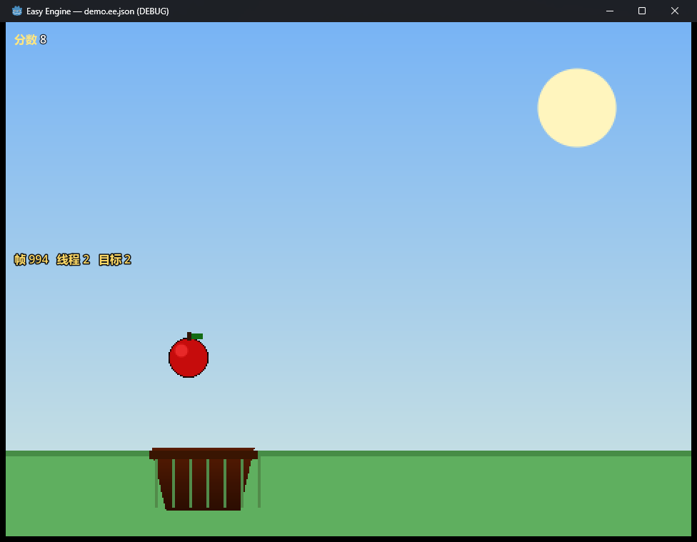

# Easy Engine

**把 Godot 的能力，用 Scratch 积木的方式暴露出来让人编程。**

定位不是"让 Godot 跑 Scratch 项目"，而是**积木 = Godot 的可视化编程语言**：让只会 Scratch 的人，用熟悉的积木直接指挥 Godot 做出可发布的游戏。

详细技术方案见 **[docs/PLAN.md](docs/PLAN.md)**。

---

## 架构一句话

```
自研编辑器（fork scratch-gui）
      ↓  .ee 项目文件（积木图 + 节点树 + 资源）
    IR 编译
      ↓
Godot 原生运行时（调度器 + 节点桥）→ 导出 Windows .exe
```

## 目录结构

```
ee\
├── engine\godot\            Godot 4.7.2-stable 源码（已验证可构建）
├── scratch\
│   ├── Gandi-IDE\           Gandi 开源组件（参考资料）
│   └── TurboWarp\           scratch-gui（编辑器基座）/ scratch-vm（调度器参考）
├── tools\
│   ├── setup-vswhere.ps1    修复 MSVC 探测（换机器必跑一次）
│   └── analyze-sb3.ps1      统计 sb3 积木用量
└── docs\PLAN.md             技术方案（定稿）
```

## 已定的四个决策

| 决策 | 结论 |
|---|---|
| 创作端 | fork `scratch-gui` 自建编辑器（编辑器开源，GPL-3.0） |
| 执行层 | Godot 原生 IR 解释器（不是内嵌 JS） |
| 平台 | Windows 桌面优先 |
| 兼容性 | **不兼容社区 .sb3**；核心任务是"把 Godot 改为积木编程" |

## 快速开始

```powershell
# 1) 修复 C++ 工具链探测（只需一次）
powershell -File .\tools\setup-vswhere.ps1

# 2) 构建 Godot
cd engine\godot
python -m SCons platform=windows target=editor arch=x86_64 accesskit=no d3d12=no -j15
# 产物：engine\godot\bin\godot.windows.editor.x86_64.exe

# 3) 查看某个 Scratch 项目用了多少积木
..\..\tools\analyze-sb3.ps1 -Path .\some-game.sb3
```

## Godot 汉化

Godot 4.7.2 的简体中文界面**官方本来就基本完整**（6420 条编辑器文案 + 4300 条属性名 + 73 条导出文案，均为 100%）。

我做的不是"从头翻译"，而是用源码级差集找出**真正会漏出英文的 98 条**并补掉，现已清零：

| 文件 | 新增 | 内容 |
|---|---|---|
| `editor/translations/editor/zh_Hans.po` | 12 | 导出面板帮助文本、`[b]Hold Shift:[/b]` 系列提示等 |
| `editor/translations/extractable/zh_Hans.po` | 86 | 文件对话框、取色器、图形节点、确认框 |

完整报告见 **[docs/汉化报告.md](docs/汉化报告.md)**，含两个更深的坑：
- **2597 条写死的报错/警告文本**永远无法通过 .po 翻译（这才是"中文界面蹦英文"的主要来源）
- **中文字体**只认 `Noto Sans CJK SC`，Windows 上装的是 `Noto Sans SC`，匹配不上会退回老旧的 `DroidSansFallback`

```powershell
python tools\extract-ttr.py engine\godot   # 权威差集：源码文案 ↔ .po
python tools\zh-todo.py engine\godot       # 筛出真·界面漏翻
python tools\zh-apply.py                   # 回填（自动跳过已存在）
```

## M3 进展：接上真实 Godot，跑出一个能玩的游戏

```powershell
powershell -File tools/run-demo.ps1 -WaitSec 10 -MoveMouse "500,600"
```



**接苹果**：鼠标控制篮子，接住落下的苹果加分。画面全部由 Godot 真实渲染：
天空渐变、太阳、草地、跟着鼠标走的篮子、落下的苹果，左上角是 Scratch 式的变量监视器。

游戏里用到了**两条逃生舱**：

| 逃生舱 | 在 Demo 里的表现 |
|---|---|
| **① 表达式** | 苹果下落速度随分数变快：`-(3 + 分数 * 0.2)` |
| **② 代码块** | 5 分之后篮子变金色：`if 分数 >= 5: node.modulate = Color(1.0, 0.82, 0.35)` |

**关键点：M2 定下的调度语义一行没改。** `runtime.gd` / `thread.gd` / `values.gd`
在这次改动里**零修改**——只换了 `node_bridge` 的实现。这就是当初把"桥"单独隔一层的回报。

坐标也只在桥里换算一次：位置 `Vector2(x, -y)`、方向 `deg_to_rad(direction - 90)`、
大小 `percent/100`。积木、编译器、调度器、op 实现全都只用 Scratch 坐标。

### 这一轮修掉的三个真 bug（都只有"真接上 Godot 才暴露"）

1. **共享的 op 上下文被嵌套求值覆盖** —— `移到 x: 鼠标x y: -140` 里的 `y` 读到了错的对象，
   导致所有角色堆在中间、分数每帧都涨
2. **着色器把 Godot 的 `modulate` 盖掉了** —— 于是「执行代码」里改 `node.modulate` 看不见效果
3. **表达式求值把线程当成了目标** —— 求值变量时去读 `thread.vars`，直接崩

M2 的 84 项测试全盖不住这三个，因为它们都发生在"桥/集成"这一层。
**这说明 M2 / M3 的边界划对了**：语义在 M2 测清，集成问题在 M3 暴露。

规格与结果：[`docs/M3-TODO.md`](docs/M3-TODO.md)

## M2 进展：调度器跑通，`.ee` 能真正运行

```powershell
powershell -File tools/test-runtime.ps1     # 一条命令跑完 M1 + M2 全部验收
```

```
1. 定义注册表        扩展 2，积木 92，op 92，错误 0
2. 示例项目校验      节点 2，脚本 3
3. IR 回归          与基准一致
4. 端到端运行示例    通过
5. 调度器测试（M2）  84 项，0 失败，无对象泄漏
M1 + M2 全部验收通过。
```

`run` 命令做到 **`.ee → IR → 真的跑起来`**：

```
$ godot --headless --path runtime --script tools/cli.gd -- run tests/sample.ee.json --frames 60
== 运行 60 帧 ==
  绿旗触发了 1 个脚本
== 全局变量 ==       分数 = 0
== 目标状态 ==       Player 位置 (100.0, 0.0)  方向 90.0  造型 默认
```

`重复执行 10 次 { 移动 10 步 }` 每帧走一步、10 帧走完、停在 x=100 ——
**帧数与位移都能对上**，这正是 M2 要证明的事。

### 被 84 项测试钉死的语义（定错了就要全盘返工）

| 语义 | 断言 |
|---|---|
| **循环每轮让步** | `重复 3 次` 第 1 帧计数=1、第 2 帧=2、第 3 帧=3 |
| **warp 内不让步** | `warp { 重复 100 次 }` 一帧跑完 |
| **帧内新线程下一帧才跑** | 广播后发送方先完成，接收方下一帧才覆盖 |
| **广播并等待** | 发送方一直等到接收方全部结束 |
| **克隆体局部变量是副本** | 克隆体改成 2，原型仍是 3 |
| **变量 auto 作用域** | 同名局部变量被写、全局同名不受影响 |
| **方向语义 0=上 90=右** | 朝右走 10 → x=10；朝上走 10 → y=−10 |
| **值语义** | `"10" > "9"` 为真、`"abc"+4`="abc4"、除以零得 Infinity |

### 三个刻意的设计决定

1. **不用协程，用显式帧栈。** 协程做不到"从外部打断一个正在等待的脚本"，
   而这正是「停止这个脚本」「删除克隆体」必需的。
2. **控制流不在调度器里。** `repeat / if / while / warp` 都是 core provider 里的普通 op，
   通过 `ctx.push_loop()` 操作线程。**扩展因此也能写自己的控制流和挂起语义。**
3. **保护阈值而不是崩溃。** warp 超时 0.5s 强制让步；单帧 200 万 op 预算兜底。
   用户写死循环时，程序不该卡死，也不该毫无提示。

规格与结果：
- [`docs/format/EE-SCHEDULER.md`](docs/format/EE-SCHEDULER.md) —— 调度语义规范（定稿）
- [`docs/M2-TODO.md`](docs/M2-TODO.md) —— 工作清单、验收结果、M2 的边界

> 顺带一提：启动时的"op 必须有实现"校验**第一次跑就抓出 3 个孤儿 op**；
> 测试跑到最后报 **199 个对象泄漏**，查明是 `Thread.target` 与 `Target.threads`
> 的引用环（GDScript 没有环回收），加 `Runtime.dispose()` 后归零。

## M1 进展：格式与 IR 已定稿

`.ee` 项目格式、IR 规范、积木↔场景同步规则**已定稿**，编译管线**已跑通**：

```powershell
powershell -File tools/test-runtime.ps1     # 一条命令跑完 M1 全部验收
```

```
1. 定义注册表   扩展 2 个，积木 95 个，op 95 个；错误 0
2. 示例项目校验  节点 2 个，脚本 3 个；（无问题）
3. IR 回归      与基准一致（5090 字节）
M1 全部验收通过。
```

### 扩展性是怎么落到格式里的（这是本次的重点）

| 约束 | 做法 | 不这么做会怎样 |
|---|---|---|
| **IR 以后要改，老项目不能坏** | `.ee` 里**只存积木 id，不存 opcode**；opcode 由积木定义映射 | 每次改 IR 都要写一批转换脚本，越写越乱 |
| **加积木不能改引擎代码** | 积木与 op 全**数据驱动**（`defs/*.json`），文件名前缀决定扩展归属 | 社区无法扩展，我们自己也慢 |
| **旧版工具不能抹掉新字段** | 加载器**从不重建字典**，只在原始字典上读写 | 用户用旧版打开新项目、一保存，新功能全没了 |
| **Godot 升级不能静默搞坏项目** | 记录 `godotApiVersion` + API 改名映射表 | 每次 Godot 大版本升级都坏一批项目 |
| **格式升级不能写 N² 个转换器** | `formatVersion` 整数 + `migrations/migrate_<a>_to_<b>.gd` 逐级迁移 | 转换脚本数量爆炸 |

规格文档：
- [`docs/format/EE-FORMAT.md`](docs/format/EE-FORMAT.md) —— 项目格式（含扩展与前向兼容）
- [`docs/format/EE-IR.md`](docs/format/EE-IR.md) —— IR 规范（含让步语义契约、两条逃生舱）
- [`docs/format/SYNC.md`](docs/format/SYNC.md) —— 积木 ↔ 场景双向同步规则

工作清单与验收结果：[`docs/M1-TODO.md`](docs/M1-TODO.md)

> 顺带一提：注册表的交叉校验在第一次运行时就抓出一个真错误——`core.control.warp`
> 引用了不存在的 op。**在编译期暴露是一行提示，在运行期暴露就是一个线上崩溃。**

## 三个最关键的认知

1. **Gandi 的 GUI 编辑器不开源**，开源的是 VM / 积木渲染 / 扩展生态。自建编辑器是必然选择。
2. **难点不在积木，在调度器。** TurboWarp 的 `thread.js` + `execute.js` + `sequencer.js` 共 1425 行，解决了所有积木语言共同的难题：让步点、warp 原子模式、广播等待、克隆体生命周期。这部分参考其设计（MPL-2.0），是控制风险的关键。
3. **元积木是"永不缺积木"的保证。** 只做 6 个通用元积木（读写属性 / 调用方法 / 连接信号 / 发信号 / 新建节点 / 实例化场景）+ `ClassDB` 自动补全，就能覆盖 Godot 几乎全部 API，不必为每个 API 手工造积木。

## 进度

- [x] **M0** 环境、源码、Godot 构建链路（SCons + MSVC 14.44 已打通）、**界面 100% 汉化**
- [x] **M1** `.ee` 格式 / IR / 同步规则定稿，编译管线跑通，扩展机制实测可用
- [x] **M2** 调度器（线程/让步/warp/广播/克隆体）+ 值语义 + 表达式求值器 + 节点桥（无渲染版）· 84 项测试全绿
- [x] **M3** 接上真实 Godot 渲染 + 逃生舱①（表达式）+ 逃生舱②（真正执行代码）→ **可玩的接苹果 Demo**（docs/shot-demo.png）
- [ ] M3.5 代码 ↔ 积木互通（GDScript → 积木）+ 自制积木
- [ ] M4 fork scratch-gui 自研编辑器（L1 积木模式 / L2 场景模式）
- [ ] M4.5 L3 引擎模式（Godot 编辑器插件 + 清理遗留痕迹）
- [ ] M5 Windows 一键发布
- [ ] M6 Godot 能力积木库（物理 / 粒子 / 着色器 / 瓦片 / 动画 / 场景 / 存档 / 相机 / 联机）
- [ ] M7 `.sb3` 导入器、素材库、云存档、Android / Web
